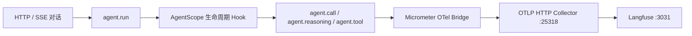

# OpenTelemetry → Langfuse

`agent.run` 映射为 chain，`agent.call` 为 agent，`agent.reasoning` 为 generation，`agent.tool` 为 tool。模型调用记录模型名称、实际返回的输入/输出/总 Token 数；没有用字符数估算用量。会话和用户通过 `langfuse.session.id`、`langfuse.user.id` 关联。异常记录错误类别，不导出可能带凭据的原始异常消息。

Collector 配置是 `infra/otel-langfuse.yaml`。它只转发带 `langfuse.observation.type` 的 Span，将业务根 Span 的外层 HTTP parent 清空，随后通过 `/api/public/otel/v1/traces`、Basic 项目密钥和 `x-langfuse-ingestion-version: 4` 发送给 Langfuse。

## 配置与启动

1. 执行 `scripts/init-integrations.ps1` 生成本地凭据。
2. 执行 `. ./scripts/load-env.ps1` 加载配置；确认 Docker Engine 已运行。
3. `docker compose --env-file .env.integrations -f compose.langfuse.yml up -d`
4. `docker compose --env-file .env.integrations -f compose.integrations.yml --profile observability up -d otel-collector`
5. 设置 `LANGFUSE_ENABLED=true`、`TRACING_ENABLED=true`，重启 Java 应用。
6. 登录 http://localhost:3031 ，选择 Corporate Travel 项目，发起一次对话并查看 Traces。

当前本机部署的 `.env.local` 中暂时关闭了 Langfuse 和追踪导出；修改 env 文件后必须重启后端。初始化脚本生成的密码只用于空 Langfuse 数据库的首次初始化，不会自动修改已有用户或项目密钥。

默认只采集结构与用量。需要查看消息、工具参数和输出时设置 `LANGFUSE_CAPTURE_CONTENT=true`，重启后生效。内容在发送前经过字段过滤和文本脱敏，限制递归深度、条数和长度；非文本/思考内容不会输出。自由文本脱敏不能代替应用侧的数据最小化，测试环境建议使用演示数据。

## 现有 Langfuse 或云端

将 Collector 环境中的 `LANGFUSE_OTEL_TRACES_ENDPOINT` 改为实际实例的完整 OTLP endpoint。`LANGFUSE_OTEL_AUTH` 必须是 `Basic ` 加上 `publicKey:secretKey` 的 UTF-8 Base64，与应用的 Langfuse 项目一致。所有 key 保存在本地 env 文件，不放进前端。

## 排障

- 后端 `/actuator/health` 正常只说明应用健康，不表示 Langfuse 已收到数据。
- Collector 日志出现 401：检查项目公钥/私钥与 Basic 编码；连接失败：检查 Docker 网络到 Langfuse 的地址。
- 当前 Compose 使用 `host.docker.internal:3031`。Langfuse 在另一台服务器时替换为实际 URL。
- 没有 generation：先确认发生了真实模型调用，并确认没有被意图路由直接回复。
- 没有 input/output：检查 `LANGFUSE_CAPTURE_CONTENT`；关闭时仍保留 Span 时间、状态、类型及 Token 用量。
- 改完 env 文件需要重新创建 Collector 容器，并重启后端。

原 `observability/` 目录里的 Prometheus/Grafana/Loki/Jaeger 栈作为可选通用监控保留，默认新链路使用本文件的 Langfuse Collector。不要让不同 Collector 争用同一 OTLP 端口。

## 验证边界

自动化测试使用真实 OpenTelemetry SDK 验证 Span 父子关系、Langfuse 属性、实际 usage、错误结束和脱敏。Compose 文件可以在没有 Docker Engine 时用 `docker compose ... config --quiet` 做结构验证。容器启动和 Langfuse UI 接收数据必须在 Docker Engine 可用后单独确认；本地测试通过不等价于完成了外部接收验证。
